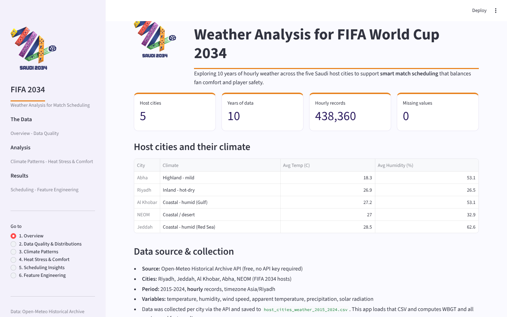

# Weather Analysis for FIFA World Cup 2034

An interactive Streamlit dashboard that analyses ten years of hourly weather in the five Saudi host cities of the 2034 World Cup (Riyadh, Jeddah, Al Khobar, Abha and NEOM) to answer one scheduling question: **when is it comfortable and safe to play?**



## Key findings

- **438K hourly weather records**, 2015–2024, from the Open-Meteo historical archive.
- A simplified **WBGT heat-stress index** (from temperature and humidity) and a **0–100 fan comfort score** were engineered, and every hour was classed as Suitable, Caution or Not Suitable for play.
- **Play-suitable hours fall from 94–98% in December–March to about 36% in July–August**, and improve sharply after sunset.

## What is inside the dashboard

| Section | Pages |
|---|---|
| **The Data** | Overview · Data quality and distributions |
| **Analysis** | Climate patterns · Heat stress and comfort |
| **Results** | Scheduling insights · Feature engineering |

## Run it

```bash
pip install -r requirements.txt
streamlit run app.py
```

The data file `host_cities_weather_2015_2024.csv` is included. The full exploratory analysis is in `Ritaj_Albogami_EDA.ipynb`.

**Tech:** Python · pandas · NumPy · Plotly · Streamlit

**Author:** Ritaj Albogami — Tuwaiq Academy AI & Data Science Diploma, 2026.
